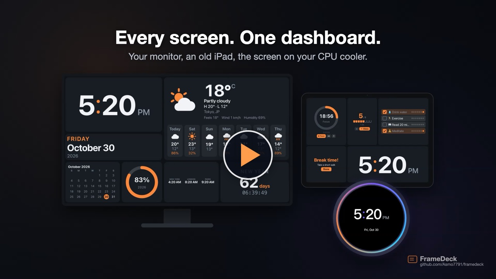
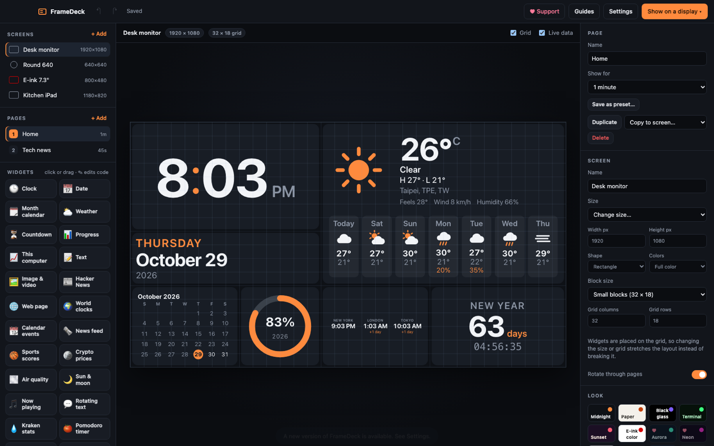
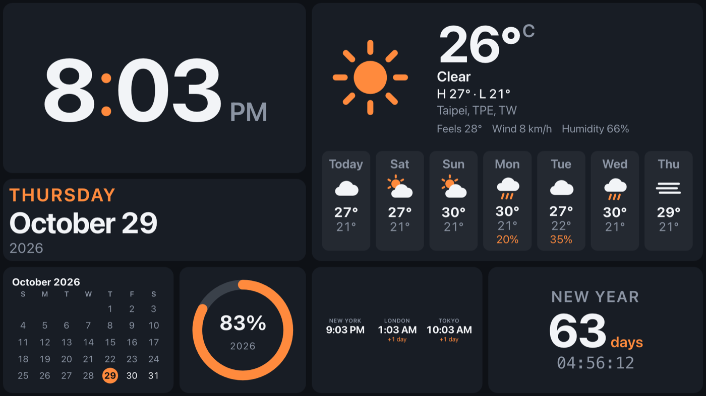
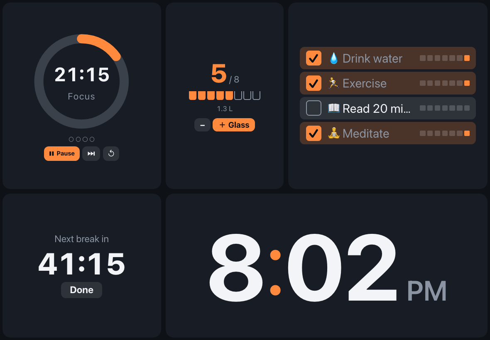
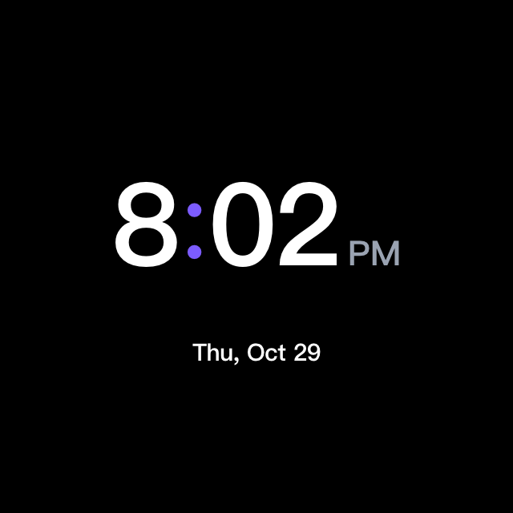
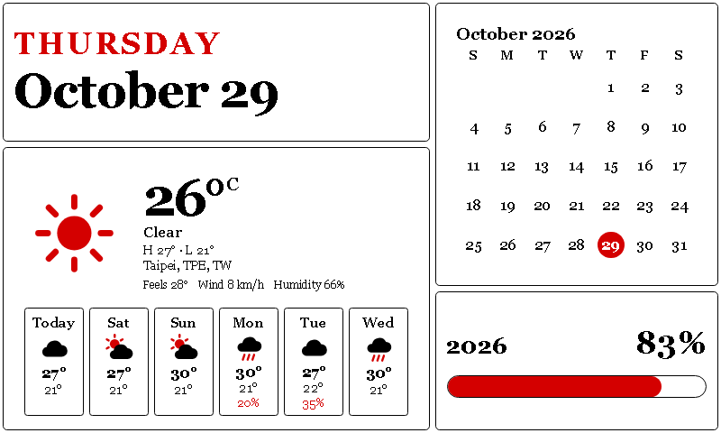
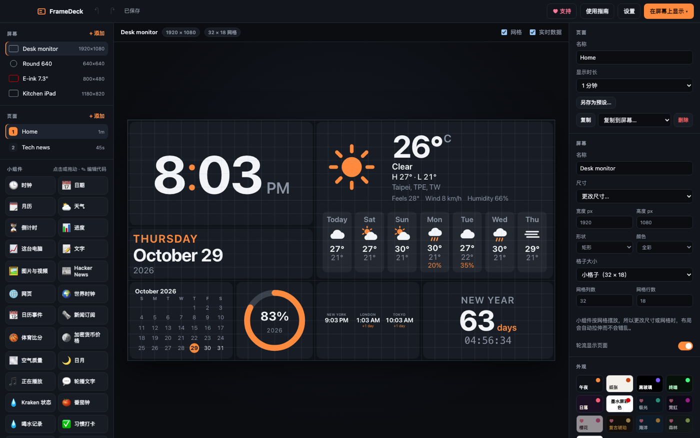

# FrameDeck

[](https://github.com/Asmo7791/framedeck/releases/latest)  

Design your own dashboard screens and show them on any display: a spare monitor, your laptop screen, a tablet or old phone on your Wi-Fi, a round cooler-style screen, or an e-ink panel.

Instead of fixed pages, every screen is a grid you lay out yourself. Widgets pick their own layout from the space they get, so the same weather widget works as a tiny icon on a 240 px round screen and as a full forecast on a 4K monitor.

[](https://cdn.jsdelivr.net/gh/Asmo7791/framedeck@main/docs/media/framedeck-promo.mp4)

▶️ **[Watch the 60-second video](https://cdn.jsdelivr.net/gh/Asmo7791/framedeck@main/docs/media/framedeck-promo.mp4)** · [15-second vertical cut](https://cdn.jsdelivr.net/gh/Asmo7791/framedeck@main/docs/media/framedeck-promo-vertical.mp4)



| On a monitor | On a tablet (tap to use) |
|---|---|
|  |  |
| **On a round cooler screen (NZXT Kraken size)** | **On an e-ink panel** |
|  |  |

Also in 简体中文 and 繁體中文:



📖 **Guides:** step-by-step setup for monitors, tablets, NZXT Kraken LCDs and Raspberry Pi, plus the widget reference, are in the **[Wiki](https://github.com/Asmo7791/framedeck/wiki)**.

## Credit

FrameDeck is inspired by [EpaperSystem](https://github.com/Feeengyuuu/EpaperSystem) by Feeengyuuu, a Raspberry Pi colour e-paper dashboard, which builds on [InkyPi](https://github.com/fatihak/InkyPi). FrameDeck doesn't copy their code; it borrows the idea of a rotating information screen and takes it to more kinds of displays. If you have a Raspberry Pi and an e-ink panel, use EpaperSystem: it's excellent.

Weather data comes from [Open-Meteo](https://open-meteo.com) (free for non-commercial use, no API key). News comes from the public Hacker News API.

## Download

### **[⬇ Download FrameDeck](https://framedeck-relay.kagura8790.workers.dev/download)**

That link picks the right file for your computer. Or choose yourself:

| System | Download |
|---|---|
| Mac (Apple silicon or Intel, macOS 12 or newer) | [FrameDeck-mac.dmg](https://github.com/Asmo7791/framedeck/releases/latest/download/FrameDeck-mac.dmg) |
| Windows 10/11 (x64 or ARM) | [FrameDeck-windows-setup.exe](https://github.com/Asmo7791/framedeck/releases/latest/download/FrameDeck-windows-setup.exe) |
| Linux and Raspberry Pi | Run the command below |
| iPhone, iPad, Android | No download: open a screen's link and **Add to Home Screen** (see Guides in the app) |

**Mac:** open the `.dmg` and drag FrameDeck into Applications. The app isn't notarized by Apple yet, so the first time, macOS says it can't check it for malware. Click **Done**, then go to **System Settings → Privacy & Security**, scroll down and click **Open Anyway**. Or run this once in Terminal, then open it normally:

```
xattr -cr /Applications/FrameDeck.app
```

**Windows:** run the setup `.exe`; it installs the right version for your PC. The app isn't signed yet, so if Windows says it protected your PC, click **More info → Run anyway**.

**Linux and Raspberry Pi:** paste this into a terminal. It works out your machine (PC, Pi 4/5, or 32-bit Pi OS) and installs the right package:

```
curl -fsSL https://raw.githubusercontent.com/Asmo7791/framedeck/main/install.sh | sh
```

Portable `.zip` / `.tar.gz` versions and every other file are on the [Releases page](https://github.com/Asmo7791/framedeck/releases/latest).

## Using it

FrameDeck speaks **English, 简体中文 and 繁體中文**. It asks on first start; change it any time in **Settings → Language**.


- **Screens** (left): one per physical display. Add one with **+ Add** and pick a size, or "Match a connected display".
- **Pages**: each screen can rotate through several pages. Set how long each page shows.
- **Widgets**: click to add, or drag onto the screen. Drag to move, drag the handles to resize, arrow keys nudge, Shift+arrows resize, ⌫ deletes, ⌘D duplicates, ⌘Z undoes.
- **Look**: themes, colors, font, card style, corner roundness, spacing. E-ink screens only offer the colors the panel can show.
- **Show on a display**: fullscreen on any connected monitor, in a window, or as a link for a browser.
- **Settings → Share displays on my network** lets phones, tablets and other computers on your Wi-Fi open display links. The editor itself only opens on your Mac.
- **Settings → Open FrameDeck when I log in**: displays that were showing when you quit reopen automatically, so a spare monitor works like a picture frame.
- **Export / Import layout** saves a screen as a `.framedeck.json` file you can back up or share.

In a display window: ← → change page, Esc closes it, double-click toggles fullscreen.

Your layouts are stored in FrameDeck's data folder (Help → Open Data Folder).

## Widgets

Clock (digital/analog, any time zone), Date (English, 中文 and more), Month calendar, Weather, Countdown, Progress (year/month/week/day), This computer (CPU/memory), Text, Image & video (photos, GIFs, looping videos up to 60 s), Hacker News and News feed (19 ready-made feeds such as BBC, NPR, The Verge and BBC 中文, or any RSS/Atom link; tap a headline to read it), World clocks, Calendar events (any iCal link, e.g. Google Calendar), Sports scores (NBA, NFL, MLB, NHL, soccer, and esports: Dota 2, League of Legends, CS2, Valorant, Overwatch, Rainbow Six and Rocket League), Crypto prices, Air quality, Sun & moon, Now playing (Spotify / Music), Rotating text, Pomodoro timer, Water tracker, Habit tracker, Move breaks (tap them on a tablet or touch screen), Kraken stats (liquid/CPU/GPU temperatures from NZXT CAM), Web page (any embeddable page, including StreamElements overlays), and **Rainmeter skins** (import a `.rmskin`; see the [wiki](https://github.com/Asmo7791/framedeck/wiki/Rainmeter-Skins)).

## Your own widgets (Widget Studio)

Under Widgets → My widgets, click **+ New**, or hover any widget and click **✎** to open its code. Widgets are plain HTML, CSS and JavaScript with a live preview at several screen sizes and a console. **Save** updates the widget everywhere; **Save as…** makes a new one and leaves the original alone. Built-in widgets you've edited can be reset to the original. Export a widget to share it; others add it with Import. Custom widget code runs in a sandbox.

## Pages and presets

Pages → **+ Add** offers **Preset** pages (laid out for the screen you're on, including round and e-ink) or a **Custom** blank page / copy. Edit a page made from a preset and use **Save to preset** or **Save as new preset…**. Presets and whole screens export to files you can share; your custom widgets go with them.

## Guides

The **Guides** button walks through: monitors, tablets and phones, **NZXT Kraken LCDs** (via NZXT CAM's Web Integration on a Windows PC), Raspberry Pi / kiosk computers, writing widgets, and presets.

## Support

FrameDeck is free. If you find it useful, the **♥ Support** button in the app has ways to donate. Supporters get a key that unlocks extra themes as a thank-you.

## Roadmap

- Kraken LCD support on Linux through liquidctl
- Pushing images to e-ink panels (Raspberry Pi / Waveshare)
- More widgets: stocks, smart home

## Develop

```
npm install
npm start              # run from source
npm run check          # syntax check + quick server test (also runs on every push)
npm run dist           # build installers for this computer's system into release/
```

Pushing a version tag (`git tag v0.2.1 && git push --tags`) builds every platform on GitHub Actions. See [PUBLISHING.md](PUBLISHING.md).

`src/` is the Electron app and local server, `app/` is the editor and display pages, `app/shared/widgets.js` is the widget library, and `addons/` holds optional add-ons such as the Rainmeter skin reader.

Bug reports and ideas are welcome in [Issues](https://github.com/Asmo7791/framedeck/issues); see [CONTRIBUTING.md](CONTRIBUTING.md). For security problems, see [SECURITY.md](SECURITY.md).

## License

[MIT](LICENSE) © 2026 Kai-Tung Yu
